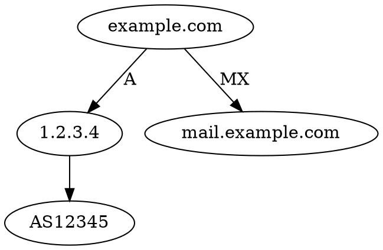

Собранные данные без отчёта бесполезны. Отчёт — это **продукт разведки**: он должен позволить другому человеку повторить ваш путь и прийти к тем же выводам. Плохой отчёт — стена текста без источников; хороший — воспроизводимая цепочка фактов с уровнями уверенности. В этом уроке — структура, фиксация доказательств, маркировка уверенности и язык.

## Принцип: воспроизводимость

Любой факт в отчёте сопровождается:

- **источником** (URL/инструмент/команда);
- **временем** сбора;
- **уровнем уверенности** (low/moderate/high);
- при возможности — **артефактом** (скриншот, сохранённая копия, хэш).

Если факт нельзя воспроизвести — это не разведданные, а слух. Воспроизводимость отличает аналитическую работу от пересказа слухов и защищает от обвинений в вымысле.

## Структура отчёта

1. **Резюме (TL;DR)** — 5–10 строк: что нашли и что это значит.
2. **Задача/требования** — какие PIR (priority intelligence requirements) закрывались.
3. **Методика** — источники и инструменты.
4. **Находки** — по каждой: факт, источник, уверенность, артефакт.
5. **Анализ** — связи, таймлайн, выводы.
6. **Приложения** — списки, скриншоты, экспорты.

Вывод — **наверху**. Занятый читатель должен получить суть за 30 секунд. Всё остальное — доказательная база под этим выводом.

## Уровни уверенности

| Уровень | Когда ставить | Формулировка |
|---|---|---|
| High | подтверждено несколькими независимыми источниками | «подтверждено» |
| Moderate | один надёжный источник, косвенные подтверждения | «вероятно» |
| Low | один источник, не проверено | «возможно» |

Избегайте категоричности без доказательств. Полезно указывать и **источник** по системе Admiralty: надёжность источника (A–F) и достоверность информации (1–6).

## Система Admiralty

Классическая двухбуквенная маркировка:

- **Надёжность источника (A–F):** A — полностью надёжный, B — обычно надёжный, C — довольно надёжный, D — не всегда надёжный, E — ненадёжный, F — надёжность не определена.
- **Достоверность информации (1–6):** 1 — подтверждено другими источниками, 2 — вероятно истинно, 3 — возможно истинно, 4 — сомнительно, 5 — неправдоподобно, 6 — не проверено.

Пример пометки: **B2** — «обычно надёжный источник, вероятно истинно». Это даёт читателю быструю оценку без чтения всего обоснования.

## Фиксация доказательств

- **Скриншоты** — с URL и датой в кадре.
- **Копии страниц** — сохранённый HTML/PDF, архивирование в Wayback.
- **Хэши** файлов — `sha256sum`.
- **Логи команд** — `script` или ручное сохранение вывода.
- **Таймлайн** — единый часовой пояс (обычно UTC).

```bash
# Зафиксировать артефакт с метаданными
curl -s https://example.com/page -o page.html
sha256sum page.html | tee page.sha256
date -u | tee collected_at.txt
```

Вывод:

```text
9a1b2c3d4e5f...  page.html
Sun Oct 11 14:22:31 UTC 2026
```

Хэш доказывает, что сохранённая копия не менялась после сбора. Без него через месяц нельзя доказать, что страница выглядела именно так.

## Визуализация

- **Граф связей** (Maltego/yEd/Graphviz) — сущности и рёбра.
- **Таймлайн** — события по датам.
- **Таблица** — хосты, порты, сервисы, статус.



Рендер: `dot -Tpng graph.dot -o graph.png`. Граф лучше текста показывает, «кто с кем связан», и часто вскрывает пробелы.

## Язык и этика

- Отделяйте **факт** от **интерпретации**.
- Не публикуйте персональные данные без необходимости.
- Указывайте ограничения: «не проверено», «источник сомнительный».
- Для CTF — чётко укажите флаг и путь его получения.
- Для bug bounty — воспроизводимые шаги и impact.

## Разобранный пример

Отчёт по домену `example.com`:

```text
TL;DR: 14 поддоменов, 2 вне продакшена, 1 публичный бакет с бэкапом (high).

PIR-1 (внешняя поверхность): закрыт.
  - Найдено 14 поддоменов (crt.sh, subfinder) — moderate.
  - 2 поддомена отдают staging-страницы (curl -I) — high.
PIR-2 (утечки): закрыт.
  - Публичный S3-бакет example-static-dev (200, XML listing) — high.
    Артефакт: listing.xml, sha256 9a1b...
Методика: crt.sh → subfinder → httpx → curl; Wayback.
```

Обратите внимание: каждый пункт имеет уровень уверенности и (где нужно) артефакт. Читатель может проверить любой пункт.

## Шаблон отчёта

Готовый каркас, который можно копировать:

```markdown
# OSINT-отчёт: <цель>
Дата: <YYYY-MM-DD>  |  Аналитик: <...>  |  Классификация: <...>

## 1. Резюме (TL;DR)
- <3–5 ключевых фактов с уровнем уверенности>

## 2. Задача
- PIR-1: ...
- PIR-2: ...

## 3. Методика
- Источники: <список>, инструменты: <список>

## 4. Находки
| # | Факт | Источник | Дата | Уверенность | Артефакт |
|---|------|----------|------|-------------|----------|
| 1 | ...  | ...      | ...  | high        | sha256...|

## 5. Анализ
- Связи, таймлайн, выводы

## 6. Приложения
- Скриншоты, экспорты, граф
```

Таблица находок — сердце отчёта: она делает каждый факт проверяемым.

## Типичные ошибки отчётности и как их избежать

| Ошибка | Как исправить |
|---|---|
| Вывод в конце | Резюме наверху |
| Нет источников | Ссылка на каждый факт |
| Смешение факта и мнения | Отдельные разделы «Факт»/«Интерпретация» |
| Нет уровней уверенности | Маркировка Admiralty/confidence |
| Разные часовые пояса | Единый UTC |
| Потеря артефактов | Сохранять копии + хэши |
| «Стена текста» | Таблицы, граф, таймлайн |

## Частые ошибки

- **Вывод внизу отчёта.** Читатель не дойдёт.
- **Нет ссылок на источники** → невозможно проверить.
- **Смешение фактов и домыслов.**
- **Отсутствие уровней уверенности.**
- **Потеря артефактов** (страницы изменились, пасты удалены).
- **Разные часовые пояса** в таймлайне.
- **Нумерация без легенды.** «Источник 3» без расшифровки бесполезен.

## Что дальше / решение

Отчёт — не финал, а инструмент принятия решений. После сдачи:

- **Обратная связь:** какие PIR остались открыты → новый цикл сбора.
- **Мониторинг:** поставьте на паузу изменяющиеся артефакты (Wayback, CT-логи).
- **Повторная проверка:** через N дней перепроверьте ключевые факты — среда меняется.
- **Передача:** отчёт должен читаться без вас; если требует устных пояснений — он неполный.

Решение: отчёт готов, когда (1) вывод наверху, (2) каждый факт имеет источник/дату/уверенность, (3) артефакты сохранены и захэшированы, (4) методика воспроизводима сторонним человеком.

## Устный брифинг и TL;DR-дисциплина

Отчёт часто приходится защищать устно. Здесь работает правило **перевёрнутой пирамиды**: сначала вывод, потом обоснование. Структура 5-минутного брифинга:

1. **Что просили** (PIR) — 15 секунд.
2. **Что нашли** (3–5 ключевых фактов с уверенностью) — 2 минуты.
3. **Что это значит** (impact) — 1 минута.
4. **Что рекомендуем** — 1 минута.
5. **Вопросы** — остаток.

Правило: если вас прервут после второго пункта, слушатель всё равно поймёт суть. Поэтому TL;DR должен быть **самодостаточным**: без «см. раздел 4».

## Версионирование и хранение отчёта

Отчёт — живой документ. Ведите версии:

| Версия | Дата | Изменение |
|---|---|---|
| 0.1 | сбор данных | черновик находок |
| 0.9 | проверка | добавлены уверенности, артефакты |
| 1.0 | сдача | финальные выводы |
| 1.1 | после фидбэка | уточнения, закрытие PIR |

Храните отчёт вместе с артефактами в структуре:

```bash
report/
├── report.md          # сам отчёт
├── evidence/          # скриншоты, дампы, PDF
├── hashes.sha256      # контрольные суммы артефактов
└── sources.md         # таблица источников
```

Проверка целостности перед сдачей:

```bash
sha256sum -c hashes.sha256
```

Вывод:

```text
evidence/page.html: OK
evidence/listing.xml: OK
```

## Чек-лист перед сдачей

- [ ] Вывод (TL;DR) — вверху, самодостаточный.
- [ ] Каждый факт имеет источник + дату + уверенность.
- [ ] Артефакты сохранены и захэшированы.
- [ ] Факты отделены от интерпретации.
- [ ] Таймлайн в едином часовом поясе (UTC).
- [ ] Указаны ограничения и открытые вопросы.
- [ ] Отчёт читается человеком без устных пояснений.
- [ ] Персональные данные — минимально необходимые.

## Автоматизация подготовки отчёта

Рутину удобно автоматизировать. Простой генератор таблицы находок из JSON:

```bash
# findings.json → markdown-таблица
jq -r '.[] | "| \(.fact) | \(.source) | \(.date) | \(.confidence) | \(.artifact) |"' findings.json
```

Вывод:

```text
| 14 поддоменов | crt.sh | 2026-10-11 | moderate | subs.txt |
| staging-страница | curl -I | 2026-10-11 | high | staging.html |
```

Это экономит время и исключает опечатки в таблице — но **вывод и анализ всё равно пишет человек**: шаблон структурирует, а не думает.

## Стиль изложения и читатель

Хороший отчёт подстраивается под читателя. Технический специалист хочет команды и артефакты; руководитель — вывод и риск. Решение — **слоистость**: резюме для всех, детали для тех, кто углубится. Избегайте жаргона без расшифровки в первом упоминании (`ASN (номер автономной системы)`). Пишите активным залогом: «мы нашли», а не «было найдено». Каждое утверждение — проверяемое. Это снижает риск неверного толкования и повышает доверие к отчёту.

## Ретенция и передача отчёта

Отчёт должен пережить смену аналитика. Правила передачи:

- **Единый источник правды** — один файл + папка артефактов, а не переписка в чате.
- **Оглавление с якорями** — читатель прыгает к нужной находке.
- **Пометки об актуальности** — «данные на 2026-10-11; через 30 дней перепроверить».
- **Контакт аналитика** — кто отвечает на вопросы по методике.
- **Классификация** — кто может читать отчёт (PII, коммерческая тайна).

Если отчёт требует устных пояснений от автора, значит, он неполон: всё необходимое должно быть в тексте.

## Квиз

```quiz
- question: "Что обязательно сопровождает каждый факт в отчёте?"
  options:
    - "Источник, время и уровень уверенности"
    - "Только дата"
    - "Ничего"
    - "Ваше мнение"
  answer: 0
- question: "Где должен быть вывод отчёта?"
  options:
    - "Вверху, в резюме"
    - "В самом конце"
    - "В середине"
    - "В приложении"
  answer: 0
- question: "Что означает уровень «high»?"
  options:
    - "Подтверждено несколькими независимыми источниками"
    - "Один непроверенный источник"
    - "Слух"
    - "Предположение"
  answer: 0
- question: "Зачем фиксировать хэш артефакта?"
  options:
    - "Чтобы доказать неизменность собранной копии"
    - "Чтобы ускорить сайт"
    - "Это не нужно"
    - "Чтобы скрыть данные"
  answer: 0
- question: "Что правильно при описании находки?"
  options:
    - "Отделять факт от интерпретации"
    - "Смешивать факты и домыслы"
    - "Не указывать источник"
    - "Публиковать все персональные данные"
  answer: 0
```

## Где пригодится

- **CTF (OSINT):** чётко показать путь к флагу.
- **Bug bounty:** убедительный отчёт = выше шанс награды.
- **Расследования/журналистика:** воспроизводимость и доказательства.
- **Работа:** стандарт отчётности SOC/TI.
